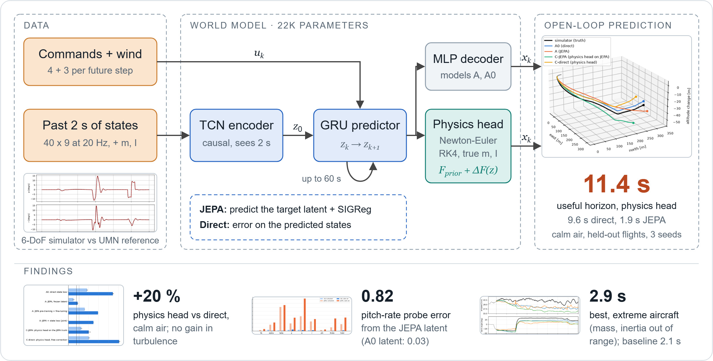

# WingJEPA: where physics should enter a learned world model of a fixed-wing UAV

[Detailed results](results/README.md) · [Implementation](docs/IMPLEMENTATION.md) · Related:
[Fixed-Wing](https://github.com/clementdumeril/Fixed-Wing), [GeneticWing](https://github.com/clementdumeril/GeneticWing)



Small world models (about 22k parameters) that predict, open loop from the four commands, how a simulated Ultra
Stick 120 flies. In calm air, a physics head trained end to end stays useful for a median 11.4 s on held-out flights
(3 seeds), against 9.6 s for the same network trained directly on the state and 1.9 s for a JEPA latent model read
out by an MLP.

## Method

Independent project for *Physics-Inspired Machine Learning* (UC Berkeley, Fall 2026), simulation only. It builds on
SkyJEPA (Rao et al., arXiv 2606.23444), which I am not affiliated with and whose code I did not use, and asks
whether that recipe carries over to a fixed-wing aircraft in turbulence and where physics should enter when the
physical model is imperfect. A causal TCN encodes 2 s of states and the aircraft mass and inertia into a 32-d latent;
a GRU rolls it forward from the commands and the wind estimate; a head reads the state back. The head is either an
MLP (A: JEPA loss, A0: state loss) or a physics head (C) that integrates Newton-Euler with RK4 and only learns a
correction to prior aerodynamic forces. The truth simulator is my Python port of the University of Minnesota UAV Lab
model (UMNUAV_sim_v4) with the NASA wind-tunnel tables.

## Results

Useful horizon: first time the prediction is off by more than 5 m in altitude, 1 m/s in airspeed or 10 deg in bank
or pitch, median over the flights. Mean over 3 seeds with (min-max), unless marked.

| Model | Calm: held-out flights (s) | Calm: extreme aircraft (s) | Calm: position error at 5 s (m) | Turbulence: held-out flights (s) |
| --- | --- | --- | --- | --- |
| Baseline: constant state | 2.15 | 2.10 | 25.4 | 1.50 |
| A0: direct state loss | 9.56 (9.12-9.98) | 2.88 (2.65-3.20) | 5.5 (5.4-5.6) | 3.58 (3.40-3.73) |
| A: JEPA, decoder on the frozen latent | 1.93 (1.90-1.95) | 0.05 (0.05-0.05) | 15.8 (15.0-17.0) | 1.23 (1.15-1.35) |
| A: JEPA pre-training, then fine-tuning | 5.85 (1 seed) | 2.30 (1 seed) | 7.2 (1 seed) | 3.10 (1 seed) |
| C-JEPA: physics head on the frozen JEPA trunk | 4.32 (4.12-4.60) | 1.57 (1.45-1.65) | 9.8 (9.6-10.0) | 2.46 (2.45-2.48) |
| **C-direct: physics head, free correction** | **11.43 (11.08-11.78)** | 2.78 (2.60-2.95) | 5.4 (5.3-5.4) | 3.57 (3.35-3.70) |
| C-direct: physics head, constrained | 3.37 (3.30-3.45) | 1.50 (1.40-1.60) | | 2.11 (2.08-2.15) |

Printed by `python scripts/results_table.py` from [`results/summary.csv`](results/summary.csv).


*Calm air, one random start per panel: 2 s of measured states (grey), then 20 s predicted from the commands alone.
A single draw, not a statistic. [Interactive version](docs/figures/trajectory_3d_calm.html) (open locally).*

- Physics helps as a flexible scaffold: in calm air C-direct beats A0 by 20 % and the seed ranges do not overlap. On
  extreme aircraft and in turbulence the gain disappears.
- The JEPA latent is the bottleneck: a probe loses the pitch rate (normalized error 0.82) and the sideslip (0.66)
  from it, against 0.04 or better from A0's latent. Every way of using JEPA stays below A0.
- A rigid physics head is worse: changing only the 38 prior coefficients once per flight gives 3.37 s, and it
  identifies only the lift coefficient.

## Install and quick start

Tested with Python 3.11 on Windows 10 (unit tests) and on Linux (training). Dependencies are not pinned.

```bash
pip install -e ".[dev]"
python -m pytest -q                       # 10 passed, about 10 s
bash scripts/fetch_umn.sh                 # NASA tables of the UMN model, not redistributed here
python scripts/results_table.py           # the table above, from the committed results
python scripts/make_figures.py --results results --out docs/figures
```

Data generation and training ran on Berkeley's Savio cluster (Slurm), from the repository root
([`cluster/README.md`](cluster/README.md)):

```bash
sbatch --array=0-19 cluster/gen_data.sbatch configs/data_v1.yaml train 20      # 2,000 training flights
sbatch --array=0-3  cluster/gen_data.sbatch configs/data_v1.yaml test_long 4   # 200 long test flights
sbatch cluster/smoke_c.sbatch                                                 # smoke test, writes the four priors
sbatch cluster/train_a.sbatch a0 0 v2T100 --T 20 --T-max 100
sbatch --time=24:00:00 cluster/train_a.sbatch c_direct 0 v2T100_ajuste --T 20 --T-max 100 --prior data/data_v1/priors/ajuste.json
sbatch cluster/make_assets.sbatch                                             # tests, results/, figures
```

## Code structure

| Path | Content |
| --- | --- |
| `wingjepa/sim/` | 6-DoF Ultra Stick 120 simulator, Dryden turbulence and gusts, TECS autopilot |
| `wingjepa/models/` | TCN encoder, GRU predictor, MLP decoder (`jepa.py`), physics head (`physics.py`) |
| `scripts/` | flight generation, prior fitting, training, evaluation, figures |
| `cluster/` | Slurm jobs |
| `results/` | per-run configs and evaluations, `summary.csv` |
| `docs/` | [implementation details](docs/IMPLEMENTATION.md), all figures |

## Limitations

- Simulation only; the comparison with real Ultra Stick 120 flight logs is not done.
- Three seeds for the main models, one for the prior variants, the JEPA variants and the joint model.
- My JEPA follows the paper, not released code; a tuning I did not try could change its numbers.
- The models ignore the wind input, and the flights come from my autopilot, which shapes the states they see.
- Not done yet: results with the command-history encoder (`--action-history`), the physics-in-loss model B, the
  port-Hamiltonian head D, and a report.

## Credits and citation

Simulator model: University of Minnesota UAV Research Group (UMNUAV_sim_v4, BSD) with NASA Langley wind-tunnel
tables. Ideas from SkyJEPA, LeJEPA (SIGReg) and APHYNITY; full list in [docs/IMPLEMENTATION.md](docs/IMPLEMENTATION.md).

Clément Dumeril, [clement.dumeril.net](https://clement.dumeril.net). MIT license ([LICENSE](LICENSE)); citation
metadata in [CITATION.cff](CITATION.cff).
