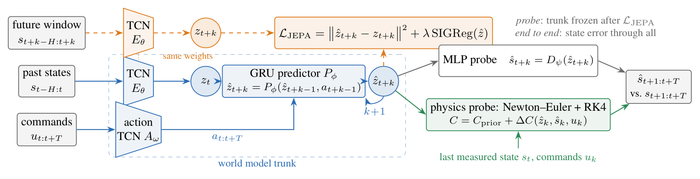
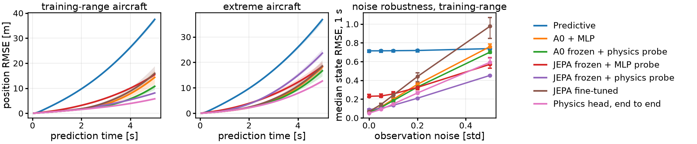

# WingJEPA: a learned world model of a fixed-wing drone, with physics inside



*Blue: the world-model trunk (encoder, action encoder, GRU predictor). Orange: the JEPA target, used only in training.
Green and gray: the readout heads. In flight only the trunk and one head run, restarted from the last measurement.*



*Open-loop prediction on unseen flights: the physics head trained end to end (pink) has the lowest position error on
both aircraft sets. Mean of 3 seeds.*

A small world model (TCN encoders, GRU predictor, about 11k parameters) that learns to predict how a simulated
fixed-wing drone (Ultra Stick 120) will fly from its recent states and the commands, so it can serve as a learned
simulator. Independent project for *Physics-Inspired Machine Learning*, UC Berkeley, Fall 2026. Simulation only.

- Trained end to end with the network, a Newton-Euler physics head predicts 5 s of flight within 5.8 m of position
  error, against 8.1 m for the same head on a frozen JEPA latent: the recipe of SkyJEPA, a recent paper I reproduced
  on the fixed wing.
- The same network without physics reaches 14.3 m. Part of that gap may come from the mass and inertia, which only
  the physics heads are given.
- Inside an MPPI controller that picks the commands, the model gives 34% less airspeed error than the TECS autopilot
  (1.00 against 1.52 m/s), and all 40 aircraft keep flying at every sensor-noise level tested.

[Poster (PDF)](poster/poster.pdf) · [Detailed results](docs/RESULTS.md) · [Implementation](docs/IMPLEMENTATION.md) · [Earlier experiments](results/README.md) ·
Related: [Fixed-Wing](https://github.com/clementdumeril/Fixed-Wing), [GeneticWing](https://github.com/clementdumeril/GeneticWing)

## How it works

- Simulator: a Python port of the University of Minnesota Ultra Stick 120 6-DoF model (NASA wind-tunnel tables),
  checked against the UMN reference trajectories.
- Data: 2,000 training flights and 200 test flights flown by a TECS autopilot, each on a random aircraft (mass,
  inertia, aerodynamics, motor varied by 3 to 30 %); half of the test flights use aircraft outside that range.
- Model: causal TCN encoders read 0.55 s of history, a GRU rolls the latent state forward with the commands, and a
  head turns it into the next state.
- Physics head: it outputs aerodynamic coefficients and integrates Newton-Euler with RK4, trained end to end with the
  network.
- Control: MPPI (256 samples, 1.5 s horizon) plans the commands with the model; gains tuned once and kept for every
  model.

## Run it

Python 3.11, tested on Windows 10 (unit tests) and Linux (training):

```bash
pip install -e ".[dev]"
python -m pytest -q
bash scripts/fetch_umn.sh                 # NASA tables of the UMN model, not redistributed here
python scripts/plot_paper.py --runs results --out docs/figures/paper_fig2.pdf          # figures from the committed results
python scripts/plot_closed_loop.py --dir results/closed_loop --out docs/figures/closed_loop_noise.pdf
```

Data generation, training and the closed-loop test: [docs/RESULTS.md](docs/RESULTS.md#reproduce).

## Limitations

- Simulation only, and the flights come from my autopilot, which shapes the states the models see.
- The physics head is given the true mass and inertia; the models without physics get no aircraft parameters, so
  they are not a clean control for it (a run of A0 with the aircraft parameters is next).
- States are fully observed and the test noise is white.
- In an earlier setting with turbulence, the gain from the physics head disappears ([results](results/README.md)).

## Credits

Simulator model: University of Minnesota UAV Research Group (UMNUAV_sim_v4, BSD) with NASA Langley wind-tunnel
tables. Method from SkyJEPA (Rao et al., arXiv 2606.23444), which I reproduced without its code (I am not one of its
authors); SIGReg from LeJEPA (Balestriero and LeCun, arXiv 2511.08544). Full list in
[docs/IMPLEMENTATION.md](docs/IMPLEMENTATION.md).

Clément Dumeril, [clement.dumeril.net](https://clement.dumeril.net). MIT license ([LICENSE](LICENSE)); citation
metadata in [CITATION.cff](CITATION.cff).
