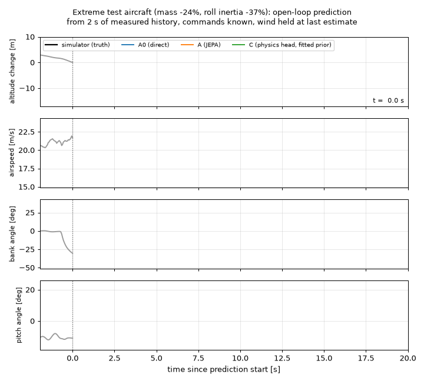
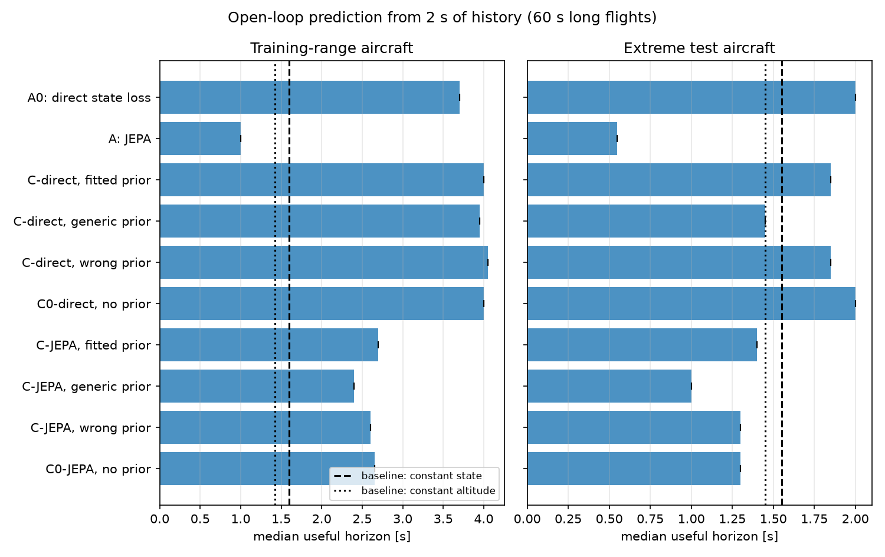
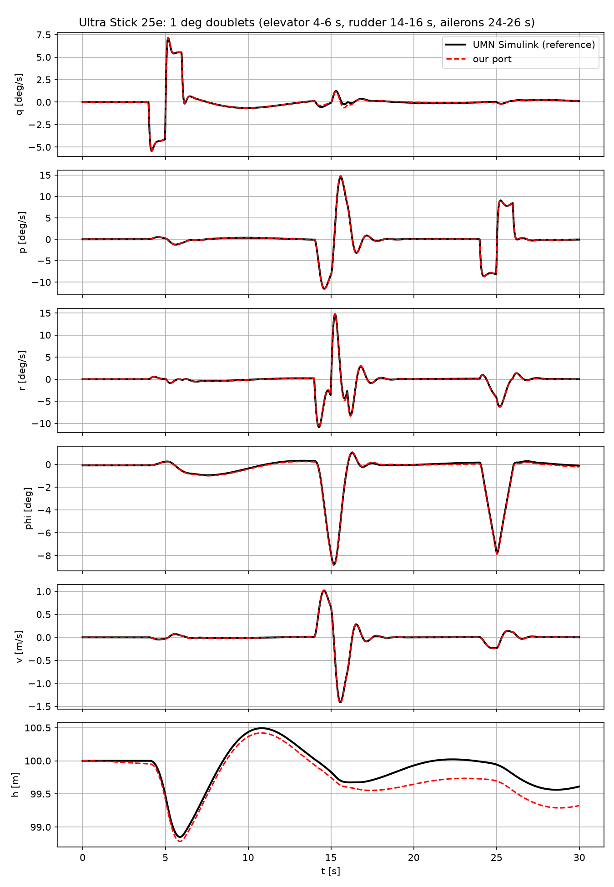

# WingJEPA: where should physics enter a latent world model of a fixed-wing UAV?

Latent world models that predict, open loop, how an Ultra Stick 120 responds to its four controls and to the wind. On long flights the best models stay within 5 m, 1 m/s and 10 deg of the simulator for a median 3.7 to 4.0 s, against 1.6 s for "nothing changes". A physics head built on Newton's equations matches the black box but does not beat it, and on aircraft outside the training range every model falls back to about 2 s.



*One start drawn at random on an extreme test aircraft. Each model sees 2 s of measured states, then only the commands applied.*

Independent project for *Physics-Inspired Machine Learning* (UC Berkeley, Fall 2026), started October 2026 and in progress. It builds on SkyJEPA (Rao et al., arXiv 2606.23444), which I am not affiliated with. The question: when the physical model given to the network is imperfect, does it help more inside the architecture than inside the loss, and does it help on aircraft the model has never seen?

| Model | Where physics enters |
|---|---|
| A0 / A | nowhere: direct state loss (A0) or JEPA latent prediction (A) |
| B | in the loss (soft physics penalty) |
| C0 | capacity control: model C with the prior set to zero |
| C | in the architecture: a physics head integrates Newton-Euler with a prior plus learned forces |
| D | in the architecture, with energy structure (port-Hamiltonian head) |

## Results

Median useful horizon: the first time the prediction is off by more than 5 m in altitude, 1 m/s in airspeed or 10 deg in bank or pitch. All models get 2 s of history plus the known mass and inertia. One seed per model; every number is in [results/summary.csv](results/summary.csv).

| Model | Held-out flights (25 s) | Long flights, training-range aircraft | Long flights, **extreme aircraft** | Altitude RMS at 60 s |
|---|---|---|---|---|
| Baseline: constant state | 1.50 s | 1.60 s | 1.55 s | 183 m |
| Baseline: constant altitude | 1.45 s | 1.43 s | 1.45 s | **36 m** |
| A0: black box, direct state loss | 3.60 s | 3.70 s | 2.00 s | 73 m |
| A: black box, JEPA | 1.15 s | 1.00 s | 0.55 s | 65 m |
| C-direct: physics head, 4 priors | 3.23 to 3.83 s | 3.95 to 4.05 s | 1.45 to 2.00 s | 121 to 180 m |
| C-JEPA: physics head on the frozen JEPA trunk, 4 priors | 2.40 to 2.45 s | 2.40 to 2.70 s | 1.00 to 1.40 s | 138 to 224 m |

Seed-to-seed spread, measured on three seeds of an earlier A0 with 0.5 s of history: 3.70 to 4.03 s on held-out flights, 1.80 to 1.95 s on extreme aircraft, 72 to 150 m in altitude at 60 s.



What I learned:
- **The physics head matches the black box but does not beat it.** Differences with A0 are within seed noise, and on extreme aircraft it drifts more in altitude over 60 s (420 to 550 m against 197 m; [altitude error vs time](assets/altitude_error.png)).
- The prior does not matter: with no aerodynamic prior at all (C0), the head does as well as with the fitted one. The learned correction absorbs whatever the prior gets wrong. With the fitted and wrong priors it does recover the missing moments (R2 0.45 to 0.78), but not the side force (R2 below 0) and barely the axial force (R2 at most 0.29): there it most likely absorbs the turbulence and actuator lag that the head cannot see.
- On a JEPA trunk, the physics head more than doubles the horizon (1.0 s to 2.4 to 2.7 s), the effect SkyJEPA reports with its physics probe. It still stays below direct training.
- JEPA-style training did worse than a direct state loss, the reverse of SkyJEPA. A probe on the latent shows it drops sideslip, which is mostly turbulence: JEPA keeps what is predictable, not what is measured.
- Training on a 5 s horizon instead of 1 s raised A0 from 2.6 s to 3.7 s on held-out flights (6.0 s in calm air). No model beats "keep the altitude constant" at 60 s.

## What I built

- Simulator (`wingjepa/sim/`): a Python 6-DoF port of the University of Minnesota UAV Lab Simulink model (UMNUAV_sim_v4) with the NASA Langley wind-tunnel tables of the Ultra Stick 120. Vectorized RK4 at 100 Hz, first-order actuators with rate limits, propeller and motor model, 1-cos gusts and Dryden turbulence (MIL-F-8785C), and a filtered wind estimate.
- Flight generator (`scripts/generate_flights.py`, `wingjepa/sim/pilot.py`): TECS autopilot for speed and altitude, bank and coordination loops, elevator/aileron/rudder excitation, random commands and engine-off segments, and an envelope protection that takes over near stall or the ground. Dataset: 2,000 flights of 30 s and 200 flights of 120 s, half of them on aircraft whose mass, inertia, aerodynamics and motor are outside the training range.
- World models (`wingjepa/models/jepa.py`): causal TCN encoder over 2 s of states (5 dilated layers, receptive field 63 steps) plus mass and inertia, a GRU predictor driven by the commands and the held wind estimate, and a head. About 22k parameters. Training modes in `scripts/train_a.py`: JEPA (latent prediction + SIGReg), direct state loss, joint, and the two physics-head variants.
- Physics head (`wingjepa/models/physics.py`): replaces the MLP decoder. It carries the body-axis state and steps the Newton-Euler equations with the true mass and inertia; forces and moments are a prior plus 6 coefficient corrections computed from the latent.
- Priors (`scripts/fit_prior.py`): fitted by least squares on the simulator (R2 0.60 to 0.93 per coefficient), generic (published Ultra Stick 25e coefficients), wrong (fitted, each coefficient off by 30 %), and none.
- Evaluation (`scripts/evaluate.py`, `scripts/diagnose.py`): open-loop rollouts up to 60 s, useful horizon, two trivial baselines, results by turbulence level and with the true wind, and for model C a check of whether the learned correction matches the physics the prior is missing.

## How it works

```
2 s of measured states + mass, inertia --TCN--> z0 --GRU (commands, wind estimate)--> z1, z2, ...
model A:  state_k = MLP(z_k)                      (re-guessed at every step)
model C:  x_{k+1} = RK4[ Newton-Euler(x_k, F_prior(x_k, u_k) + dF(z_k, x_k, u_k); m, I) ]
```

In model C the physical state is carried by the equations from one step to the next, and the network only adds corrective forces. The correction starts at zero, so an untrained head is exactly the prior, and a small penalty keeps it small (as in APHYNITY). C-direct trains everything on the state error; C-JEPA freezes a JEPA trunk and trains only the head, like the physics probe of SkyJEPA.

## How I checked it

- The simulator port matches the UMN reference trajectories to about 0.1 to 1 % of the response (`scripts/validate_ultrastick.py`).
  
- Porting the model surfaced four problems in the original, which I fixed and documented: a corrupted cell in the NASA tables (lift coefficient 4.35 instead of about -0.05), the side force applied with the wrong sign, the FASER propulsion coded with the smaller 25e motor, and the propeller-wash term disabled. The side-force sign was checked against a real Baldr flight log: the measured slope is -0.0054 to -0.0059 per deg against -0.0068 in the table.
- A unit test checks that the physics head reproduces the simulator's equations of motion to 1e-6 when given the same aerodynamic model (`tests/test_models.py`, `python -m pytest -q`).
- Dataset checks (`scripts/check_dataset.py`): energy balance closes with correlation 0.998, the response to each of the four controls has the right sign, no non-finite values.
- Every model is compared with two baselines that need no learning, and with the true wind instead of the estimate.
- New code paths run first on a short job (`cluster/smoke_c.sbatch`) before the long runs. That is how a NaN in the physics head was caught and fixed (pitch passing 90 deg inside an RK4 stage).

## Limitations

- One seed per model: differences below about 0.3 s are not meaningful yet.
- Simulation only. The comparison with real flight logs is planned, not done.
- The models ignore the wind input: giving them the true wind does not change their predictions.
- The flights come from my autopilot, which shapes the states the models see.
- The 1 m/s airspeed threshold is close to the airspeed fluctuations caused by turbulence.

## Status

- [x] 6-DoF simulator, validation, dataset
- [x] Models A and A0, diagnostics
- [x] Model C, physics head: 4 priors, direct and on a JEPA trunk (one seed)
- [ ] A tighter correction (a few physical parameters instead of free forces), so the prior has to carry the physics
- [ ] Three seeds for every model
- [ ] Models B and D
- [ ] Check on real Ultra Stick 120 flight logs (UMN)
- [ ] Report

## Reproduce

```bash
python -m venv ~/.venvs/wingjepa && source ~/.venvs/wingjepa/bin/activate
pip install -e ".[dev]"
bash scripts/fetch_umn.sh                      # NASA tables, not redistributed here
```

On Savio (see [cluster/README.md](cluster/README.md)), from the repository root:

```bash
sbatch --array=0-19 cluster/gen_data.sbatch configs/data_v1.yaml train 20
sbatch --array=0-3  cluster/gen_data.sbatch configs/data_v1.yaml test_long 4
sbatch cluster/smoke_c.sbatch                 # also writes the four priors
sbatch cluster/train_a.sbatch a0 0 v2T100 --T 20 --T-max 100
sbatch --time=24:00:00 cluster/train_a.sbatch c_direct 0 v2T100_ajuste --T 20 --T-max 100 --prior data/data_v1/priors/ajuste.json
sbatch cluster/make_assets.sbatch             # results/ and the figures of this page
```

On 16 CPU cores, A0 trains and evaluates in 1.3 h and JEPA in 8.5 h; physics-head models take 8 to 18 h because of the RK4 inside the training loop. `cluster/make_assets.sbatch` runs the unit tests, then collects the results and draws the figures of this page.

## Credits

- Simulator model and Ultra Stick 120 / 25e data: University of Minnesota UAV Research Group, UMNUAV_sim_v4 (BSD license), with wind-tunnel tables from NASA Langley. The tables are downloaded by `scripts/fetch_umn.sh` and not included here.
- Baldr flight data: University of Minnesota UAV Research Group.
- SkyJEPA, Rao et al., arXiv 2606.23444 (architecture and the idea of a physics probe).
- LeJEPA, Balestriero and LeCun, 2025 (SIGReg regularizer).
- APHYNITY, Yin et al., ICLR 2021 (keeping the learned correction to a physical model small).
- TECS, Lambregts, 1983; Beard and McLain, *Small Unmanned Aircraft*, 2012.
