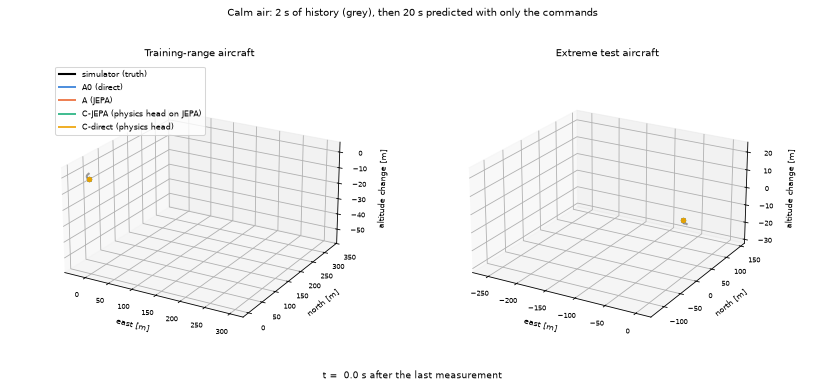
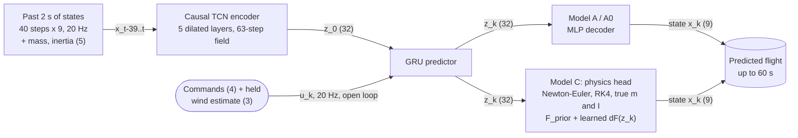
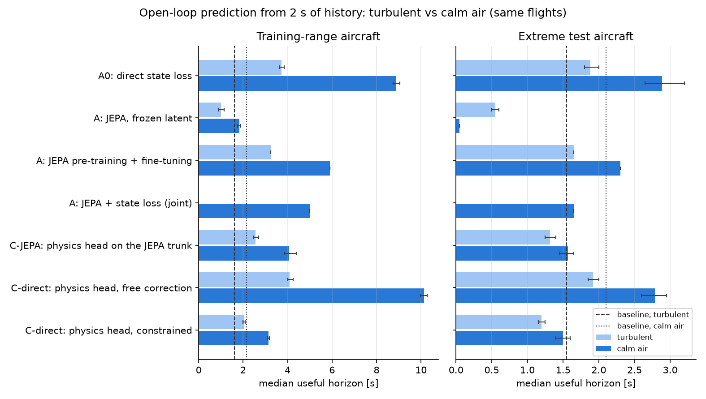

# WingJEPA: where physics should enter a learned world model of a fixed-wing UAV

Learned world models that predict, open loop from the four commands, how a simulated Ultra Stick 120 flies. In calm
air, a physics head trained end to end stays useful for a median 11.4 s on held-out flights (3 seeds), against 9.6 s
for the same network trained directly on the state and 1.9 s for a JEPA latent model read out by an MLP.

[Detailed results](results/README.md) · [Interactive 3D flight paths](assets/trajectory_3d_calm.html) (HTML, open
locally) · Related: [Fixed-Wing](https://github.com/clementdumeril/Fixed-Wing),
[GeneticWing](https://github.com/clementdumeril/GeneticWing)



*Calm air, one random start per panel. Each model sees 2 s of measured states (grey), then predicts alone for 20 s
from the commands; the flight path is rebuilt from the predicted states. A single draw, not a statistic.*

## Overview

Independent project for *Physics-Inspired Machine Learning* (UC Berkeley, Fall 2026), started October 2026 and in
progress. It builds on SkyJEPA (Rao et al., arXiv 2606.23444), a JEPA world model read out by a physics head, which I
am not affiliated with and whose code I did not use. The questions: does that recipe carry over to a fixed-wing
aircraft in turbulence, does it beat the same network trained directly, and where should physics enter when the
physical model is imperfect? Simulation only.

The truth simulator is my Python port of the University of Minnesota UAV Lab model (UMNUAV_sim_v4) with the NASA
wind-tunnel tables; the flight generator, world models, physics head, training and evaluation are mine.



*About 22k parameters. A trains the encoder and predictor with a JEPA loss (latent prediction + SIGReg), then a
decoder on the frozen latent; A0 trains the same network on the state error. C carries the body-axis state with the
equations of motion and only adds corrective forces from the latent; C-JEPA puts it on a frozen JEPA trunk,
C-direct trains everything on the state error. Code: `wingjepa/models/jepa.py`, `wingjepa/models/physics.py`.*

## Results

Useful horizon: the first time the prediction is off by more than 5 m in altitude, 1 m/s in airspeed or 10 deg in
bank or pitch, median over the flights. Position error: RMS 3D distance after 5 s, training-range aircraft. Mean over
3 seeds with (min-max), unless marked.

| Model | Calm: held-out flights (s) | Calm: extreme aircraft (s) | Calm: position error at 5 s (m) | Turbulence: held-out flights (s) |
| --- | --- | --- | --- | --- |
| Baseline: constant state | 2.15 | 2.10 | 25.4 | 1.50 |
| A0: direct state loss | 9.56 (9.12-9.98) | 2.88 (2.65-3.20) | 5.5 (5.4-5.6) | 3.58 (3.40-3.73) |
| A: JEPA, decoder on the frozen latent | 1.93 (1.90-1.95) | 0.05 (0.05-0.05) | 15.8 (15.0-17.0) | 1.23 (1.15-1.35) |
| A: JEPA pre-training, then fine-tuning | 5.85 (1 seed) | 2.30 (1 seed) | 7.2 (1 seed) | 3.10 (1 seed) |
| C-JEPA: physics head on the frozen JEPA trunk | 4.32 (4.12-4.60) | 1.57 (1.45-1.65) | 9.8 (9.6-10.0) | 2.46 (2.45-2.48) |
| C-direct: physics head, free correction | 11.43 (11.08-11.78) | 2.78 (2.60-2.95) | 5.4 (5.3-5.4) | 3.57 (3.35-3.70) |
| C-direct: physics head, constrained | 3.37 (3.30-3.45) | 1.50 (1.40-1.60) | | 2.11 (2.08-2.15) |

Printed by `python scripts/results_table.py` from [`results/summary.csv`](results/summary.csv). Long flights, the
turbulent position errors and the prior variants: [`results/README.md`](results/README.md).



*Median useful horizon per model, calm (dark) and turbulent (light) air; error bars span the seeds.*

- Physics helps as a flexible scaffold. In calm air C-direct beats A0 by 20 % on held-out flights and the seed
  ranges do not overlap; on extreme aircraft and in turbulence the gain disappears.
- The JEPA latent is the bottleneck. A probe trained to read the present state back from it loses the pitch rate
  (normalized error 0.82) and the sideslip (0.66) in calm air; from A0's latent every quantity reads back to 0.04 or
  better (`results/*/probe.json`, `assets/probe.png`). Every way of using JEPA stays below A0.
- A rigid physics head is worse. Letting the network change only the 38 aerodynamic coefficients of the prior, once
  per flight, gives 3.37 s against 11.43 s with the free correction, and it identifies only the lift coefficient.

## What I built

| Component | Path | What it is |
| --- | --- | --- |
| Truth simulator | `wingjepa/sim/ultrastick.py`, `wind.py` | 6-DoF port of UMNUAV_sim_v4: RK4 at 100 Hz, actuators with rate limits, propeller and motor, 1-cos gusts, Dryden turbulence (MIL-F-8785C), filtered wind estimate |
| Flight generator | `scripts/generate_flights.py`, `wingjepa/sim/pilot.py` | TECS speed and altitude autopilot, bank and coordination loops, excitations, envelope protection; 2,000 flights of 30 s and 200 of 120 s, half of these on extreme aircraft |
| World models | `wingjepa/models/jepa.py`, `scripts/train_a.py` | TCN encoder, GRU predictor, MLP decoder; training modes `jepa`, `jepa_ft`, `a0`, `joint`, `c_direct`, `c_jepa`; restart from checkpoint |
| Physics head | `wingjepa/models/physics.py` | Newton-Euler with the true mass and inertia, prior forces plus 6 learned coefficient corrections, or (`--correction param`) 38 prior coefficients changed once per flight |
| Priors | `scripts/fit_prior.py` | fitted by least squares, generic (published Ultra Stick 25e), wrong (30 % off), none |
| Evaluation | `scripts/evaluate.py`, `position_error.py`, `diagnose.py` | open-loop rollouts up to 60 s, useful horizon, position error, two trivial baselines, true-wind ablation, latent probe |
| Results and figures | `scripts/collect_results.py`, `results_table.py`, `make_figures.py`, `make_trajectory_3d.py` | `results/summary.csv`, the table and figures of this page |
| Savio jobs | `cluster/` | data generation, training, smoke tests, figure export |

Checks: unit tests show the physics head reproduces the simulator's equations of motion to a relative 1e-6 when
given the same aerodynamic model, and that the position rebuilt from the states is exact on a line and a turn. The
port is compared with the UMN Simulink reference trajectories ([figure](assets/validation/ultrastick25e_vs_umn_6dof.png)).
Porting surfaced problems in the original model, which I fixed in `wingjepa/sim/ultrastick.py`: a corrupted cell of
the NASA tables (a lift increment of 4.352), the side force applied with the wrong sign, the FASER propulsion coded
with the smaller 25e motor, and the propeller-wash term disabled.

## Installation

Tested with Python 3.11 on Windows 10 (unit tests) and on Savio (Linux, training). Dependencies are not pinned.

```bash
python -m venv ~/.venvs/wingjepa && source ~/.venvs/wingjepa/bin/activate
pip install -e ".[dev]"
python -m pytest -q                            # 10 passed, about 10 s
bash scripts/fetch_umn.sh                      # NASA tables of the UMN model, not redistributed here
```

## Usage

Data and training run on Savio ([`cluster/README.md`](cluster/README.md)), from the repository root:

```bash
sbatch --array=0-19 cluster/gen_data.sbatch configs/data_v1.yaml train 20      # 2,000 training flights
sbatch --array=0-3  cluster/gen_data.sbatch configs/data_v1.yaml test_long 4   # 200 long test flights
sbatch cluster/smoke_c.sbatch                                                 # smoke test, writes the four priors
sbatch cluster/train_a.sbatch a0 0 v2T100 --T 20 --T-max 100
sbatch --time=24:00:00 cluster/train_a.sbatch c_direct 0 v2T100_ajuste --T 20 --T-max 100 --prior data/data_v1/priors/ajuste.json
sbatch cluster/make_assets.sbatch                                             # tests, results/, figures
```

The calm-air runs use the same commands with `configs/data_calm.yaml`. Each run writes `config.json`, `log.json`,
`eval_train.json` and `eval_test_long.json`, copied to `results/<run>/` by `scripts/collect_results.py`. From
`log.json`: A0 trains in 1.7 h on 4 CPU threads, C-direct in 7.7 h on 2 threads with `--compile 1` (the RK4 is inside
the training loop). Model weights stay on the cluster.

## Reproducing figures

Without data or models, from the committed results:

```bash
python scripts/results_table.py                                # the table above
python scripts/make_figures.py --results results --out assets  # calm_vs_turbulence.png, position_error.png, probe.png, ...
```

The 3D flight paths and the rollout GIF need the data and the trained models (`cluster/make_assets.sbatch`).

## Limitations

- Simulation only; the comparison with real Ultra Stick 120 flight logs is planned, not done.
- Three seeds for the main models, one for the prior variants, the JEPA variants and the joint model.
- My JEPA implementation follows the paper, not released code; a tuning I did not try could change its numbers.
- The models ignore the wind input: giving them the true wind does not change their predictions.
- The flights come from my autopilot, which shapes the states the models see.
- The 1 m/s airspeed threshold is close to the airspeed fluctuations caused by turbulence.
- Not done yet: the command-history encoder (implemented, `--action-history`, no results), the physics-in-loss model
  B and the port-Hamiltonian head D, and a report.

## Credits

- Simulator model and Ultra Stick 120 / 25e data: University of Minnesota UAV Research Group, UMNUAV_sim_v4 (BSD
  license), with wind-tunnel tables from NASA Langley, downloaded by `scripts/fetch_umn.sh`.
- SkyJEPA: Rao et al., arXiv 2606.23444 (architecture and the idea of a physics probe).
- LeJEPA: Balestriero and LeCun, 2025 (SIGReg regularizer).
- APHYNITY: Yin et al., ICLR 2021 (keeping the learned correction to a physical model small).
- TECS: Lambregts, 1983; R. Beard and T. McLain, *Small Unmanned Aircraft*, 2012.

Clément Dumeril, [clement.dumeril.net](https://clement.dumeril.net). MIT license, see [LICENSE](LICENSE); citation
metadata in [CITATION.cff](CITATION.cff).
