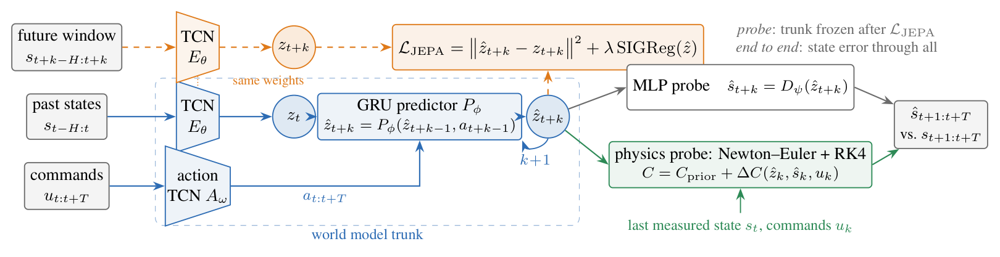
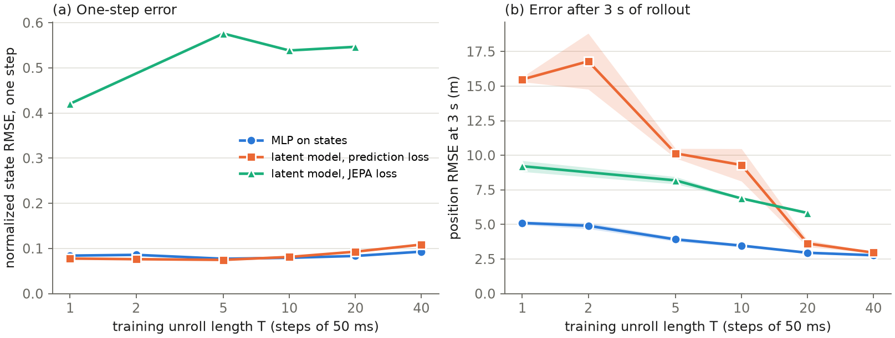

# WingJEPA: a learned world model of a fixed-wing drone, with physics inside



*Blue: the world-model trunk (encoder, action encoder, GRU predictor). Orange: the JEPA target, used only in training.
Green and gray: the readout heads. In flight only the trunk and one head run, restarted from the last measurement.*

A small world model (TCN encoders, GRU predictor, about 11k parameters) that learns to predict how a simulated
fixed-wing drone will fly from its recent states and the commands, so it can serve as a learned simulator.
Independent project for *Physics-Inspired Machine Learning*, UC Berkeley, Fall 2026. Simulation only.

The project now runs the test suite of SkyJEPA (Rao et al., arXiv 2606.23444) on PX4's `advanced_plane`, the
fixed-wing model of the PX4 Gazebo simulation: the recipes of their Table III, the same metrics, and a closed-loop
test. First results below; the closed-loop runs are in progress on Savio.

[Ultra Stick study (archived)](archive/ultrastick/README.txt) · [Implementation](docs/IMPLEMENTATION.md) · Related: [Fixed-Wing](https://github.com/clementdumeril/Fixed-Wing),
[GeneticWing](https://github.com/clementdumeril/GeneticWing)

## How it works

- Simulator: `wingjepa/sim/advanced_plane.py`, a Python port of the `advanced_plane` as Gazebo flies it
  (AdvancedLiftDrag with its post-stall blend, MulticopterMotorModel propeller, servos), checked against a C++
  transliteration (`tools/compare_advanced_cpp/`).
- Data: `configs/data_advanced.yaml`, SkyJEPA's volume: 20,000 training flights of 10 s and 400 test flights of 60 s
  at 20 Hz, flown by a TECS autopilot, each on a random aircraft (mass, inertia, aerodynamics, motor, CG, servos);
  half of the test flights use aircraft outside the training ranges. `data_advanced_turb.yaml` adds turbulence;
  `data_advanced_upset.yaml` has 15 s flights, half of them starting in an upset (steep bank, nose high or low, slow
  or fast) that the autopilot recovers from, in gusty air.
- Model: causal TCN encoders read 0.55 s of history, a GRU rolls the latent state forward with the commands, and a
  head turns it into the next state: an MLP, or a physics head that outputs aerodynamic coefficients and integrates
  Newton-Euler with RK4.
- Recipes (`scripts/train_a.py --mode`):

| SkyJEPA, Table III | Here |
| --- | --- |
| Predictive | `a0 --T 1 --T-max 1` |
| Predictive + physics regularization | `a0 --T 1 --T-max 1 --lambda-phys 1` |
| Reconstruction + prober / physics prober | `a0`, then `c_jepa --trunk <a0 run>` |
| JEPA + prober / physics prober | `jepa`, then `c_jepa --trunk <jepa run>` |
| (extra) physics head trained end to end, plain MLP | `c_direct`, `mlp_direct` |

- Evaluation: `scripts/eval_skyjepa.py` (position, velocity and attitude error, compounding ratio, straightening,
  observation noise) and `scripts/closed_loop.py` (MPPI with each model against the TECS autopilot).

## First result: the training unroll matters more than the objective



*The 200 test flights on aircraft outside the training ranges, mean of 3 seeds (band: one standard deviation). Data in
[results/tsweep.csv](results/tsweep.csv), figure from `scripts/plot_tsweep.py`.*

Each model is trained on rollouts of T steps (`train_a.py --T t --T-max t`) and then predicts alone from the commands.

- The one-step error barely moves with T (panel a). The rollout length does not make a better one-step predictor; it
  teaches the model to stay stable on its own predictions: the error after 3 s drops from 15.5 m to 3.6 m for the
  latent model, and from 5.1 m to 3.0 m for the MLP.
- The latent model needs it far more than the MLP: at T = 1 both have the same one-step error, but the latent model is
  three times worse after 3 s.
- Prediction loss against JEPA loss, position error at 3 s:

| | T = 1 | T = 20 |
| --- | --- | --- |
| prediction loss (`a0`) | 15.5 ± 0.2 m | 3.6 ± 0.3 m |
| JEPA loss (`jepa`) | 9.2 ± 0.4 m | 5.8 ± 0.1 m |

  The JEPA loss helps only with one-step training. As I read SkyJEPA (its eq. 4), its Predictive baseline is trained
  on one step while its JEPA unrolls 20; if so, part of the gap it reports may come from the unroll rather than from
  the objective.
- The MLP on states is the best at every T (2.8 m at T = 40).

## Run it

Python 3.11, tested on Windows 10 (unit tests) and Linux (training):

```bash
pip install -e ".[dev]"
python -m pytest -q tests
python scripts/generate_flights.py --config configs/data_advanced.yaml --set train --shard 0 --n-shards 20
python scripts/check_dataset.py --dir data/data_advanced --set train --g 9.8
S="--H 11 --channels 8,8,16 --dilations 1,2,4 --z-dim 24 --aircraft-input 0 --action-encoder 1 --T 20"
P=configs/priors/advanced_plane_nul.json
python scripts/train_a.py --data-dir data/data_advanced --out runs/jepa_adv_s0 --mode jepa $S
python scripts/train_a.py --data-dir data/data_advanced --out runs/c_jepa_adv_s0 --mode c_jepa $S --prior $P \
    --trunk runs/jepa_adv_s0
python scripts/eval_skyjepa.py --data-dir data/data_advanced --models runs/jepa_adv_s0 runs/c_jepa_adv_s0
python scripts/closed_loop.py --config configs/data_advanced.yaml --controllers tecs runs/c_jepa_adv_s0 \
    --out runs/closed_loop/adv.json
```

On Savio: `cluster/gen_data.sbatch`, `cluster/train_a.sbatch` and `cluster/smoke_advanced.sbatch`, a quick check of
every recipe ([cluster/README.md](cluster/README.md)). `scripts/idfds_to_npz.py` converts real PX4 flights (IDF-DS)
to the same format.

## The Ultra Stick study

The first study flew a simulated Ultra Stick 120 (a port of the University of Minnesota 6-DoF model with NASA
wind-tunnel tables). There, the physics head trained end to end predicted 5 s of flight within 5.8 m of position
error, against 8.1 m for SkyJEPA's frozen physics probe and 14.3 m for the same network without physics.
[Results](docs/RESULTS.md), [code and how to rerun it](archive/ultrastick/README.txt) (the tag `ultrastick-final`
reproduces them).

## Limitations

- Simulation only, and the flights come from my autopilot, which shapes the states the models see.
- The physics head is given the true mass and inertia; the models without physics get no aircraft parameters.
- States are fully observed and the test noise is white.

## Credits

Aircraft model: PX4's `advanced_plane` (PX4 Gazebo models). Ultra Stick study: University of Minnesota UAV Research
Group (UMNUAV_sim_v4, BSD) with NASA Langley wind-tunnel tables. Method from SkyJEPA (Rao et al., arXiv 2606.23444),
which I reproduced without its code (I am not one of its authors); SIGReg from LeJEPA (Balestriero and LeCun, arXiv
2511.08544). Full list in [docs/IMPLEMENTATION.md](docs/IMPLEMENTATION.md).

Clément Dumeril, [clement.dumeril.net](https://clement.dumeril.net). MIT license ([LICENSE](LICENSE)); citation
metadata in [CITATION.cff](CITATION.cff).
