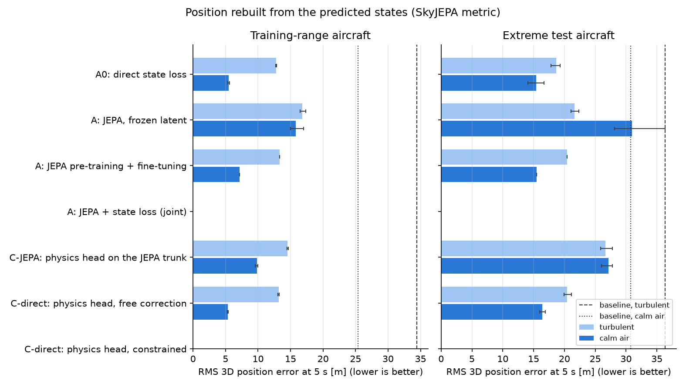
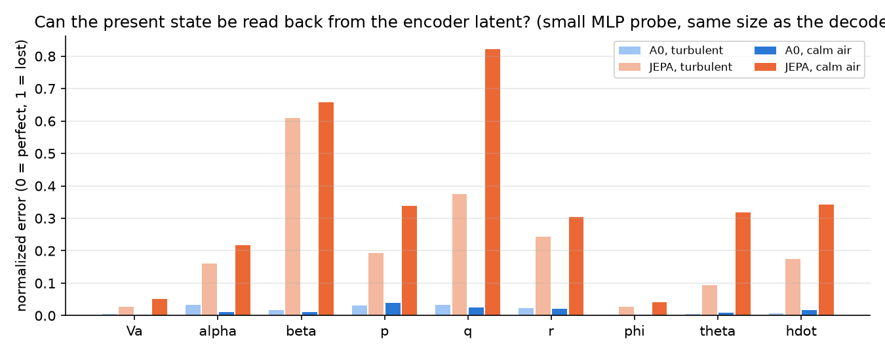
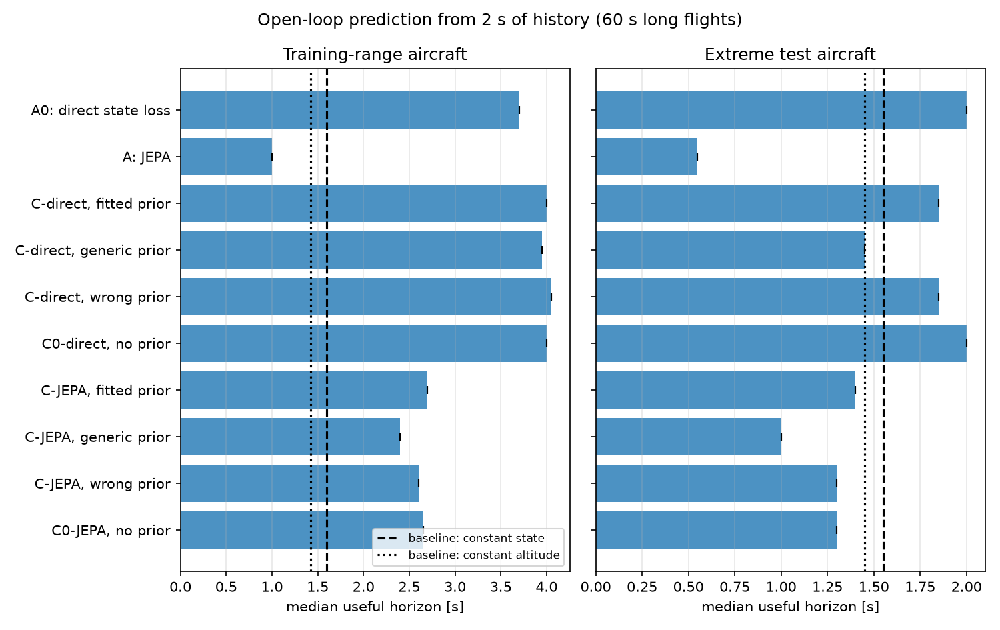
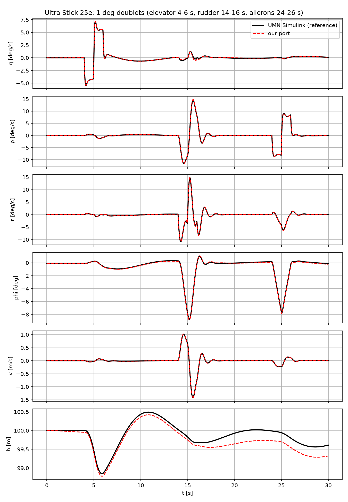

# WingJEPA: where should physics enter a latent world model of a fixed-wing UAV?

Latent world models that predict, open loop, how an Ultra Stick 120 responds to its four controls and to the wind. In calm air, a physics head trained end to end is the best model I have: over three seeds it stays within 5 m, 1 m/s and 10 deg of the simulator for a median 11.4 s on held-out flights, against 9.6 s for the same network trained directly on the state, 4.3 s for JEPA read out by a physics head (the SkyJEPA recipe) and 1.9 s for JEPA alone. The JEPA latent is the bottleneck: it drops the pitch rate and the sideslip, even in calm air. In turbulence every model falls to about 4 s or less, and on aircraft outside the training range none goes beyond 3 s.


*Calm air, one start drawn at random per panel. Each model sees 2 s of measured states (grey), then predicts alone for 20 s from the commands; the flight path is rebuilt from the predicted states. A single draw, not a statistic: the tables below average over all flights. [Interactive 3D version](https://clementdumeril.github.io/WingJEPA/assets/trajectory_3d_calm.html) (rotate, scrub through time, hide models).*

Independent project for *Physics-Inspired Machine Learning* (UC Berkeley, Fall 2026), started October 2026 and in progress. It builds on SkyJEPA (Rao et al., arXiv 2606.23444), which I am not affiliated with. The questions: does the SkyJEPA recipe (a JEPA world model read out by a physics head) carry over to a fixed-wing aircraft flying in turbulence, does it beat the same network trained directly, and where should physics enter when the physical model is imperfect?

| Model | Where physics enters |
|---|---|
| A0 / A | nowhere: direct state loss (A0) or JEPA latent prediction (A) |
| B | in the loss (soft physics penalty) |
| C0 | capacity control: model C with the prior set to zero |
| C | in the architecture: a physics head integrates Newton-Euler with a prior plus learned forces (free correction) |
| C, constrained | in the architecture, rigidly: the network may only change the 38 aerodynamic coefficients of the prior, once per flight |
| D | in the architecture, with energy structure (port-Hamiltonian head) |

## Results

Median useful horizon: the first time the prediction is off by more than 5 m in altitude, 1 m/s in airspeed or 10 deg in bank or pitch. Position error: the RMS 3D distance after 5 s, rebuilt from the predicted states, the metric SkyJEPA reports. All models get 2 s of history plus the known mass and inertia, and are trained and tested on the same flights, once in calm air and once in turbulence. Mean over three seeds (one where marked); per-run numbers are in [results/summary.csv](results/summary.csv).

### Calm air

| Model | Held-out flights | Long flights, training-range aircraft | Long flights, **extreme aircraft** | Position error at 5 s (training-range / extreme) |
|---|---|---|---|---|
| Baseline: constant state | 2.15 s | 2.15 s | 2.10 s | 25.4 / 30.8 m |
| A0: direct state loss | 9.56 s | 8.89 s | **2.88 s** | 5.5 / **15.4** m |
| A: JEPA, decoder on the frozen latent | 1.93 s | 1.83 s | 0.05 s | 15.8 / 30.9 m |
| A: JEPA pre-training, then fine-tuning (1 seed) | 5.85 s | 5.90 s | 2.30 s | 7.2 / 15.5 m |
| A: JEPA + state loss, trained jointly (1 seed) | 5.15 s | 5.00 s | 1.65 s | |
| C-JEPA: physics head on the frozen JEPA trunk | 4.32 s | 4.07 s | 1.57 s | 9.8 / 27.2 m |
| C-direct: physics head, free correction | **11.43 s** | **10.15 s** | 2.78 s | **5.4** / 16.4 m |
| C-direct: physics head, constrained | 3.37 s | 3.14 s | 1.50 s | |




What I learned:
- **Physics helps most as a flexible scaffold.** In calm air the physics head trained end to end beats the same network trained directly by 20 % on held-out flights (11.4 against 9.6 s) and 14 % on the long flights of training-range aircraft (10.2 against 8.9 s); the seed ranges do not overlap. The position error at 5 s is the same (5.4 against 5.5 m), and on extreme aircraft there is no gain (2.8 against 2.9 s). In turbulence the gain mostly disappears.
- **The JEPA latent is the bottleneck, and the cause is the objective, not turbulence.** A small probe trained to read the present state back from the latent loses the pitch rate (normalized error 0.82) and the sideslip (0.66) in calm air, more than in turbulence; from the latent of A0 every quantity reads back to 0.04 or better (figure below). JEPA predicts its own latent, and dropping fast, hard-to-predict variables makes that easier. Every way of using JEPA stays below A0: fine-tuning reaches 5.9 s, and adding the JEPA loss to the state loss (joint) costs 44 % of A0's horizon (8.9 to 5.0 s).
- **Turbulence explains about half of the gap with SkyJEPA.** The physics head improves JEPA's position error at 5 s by 38 % in calm air (15.8 to 9.8 m), 13 % in turbulence (16.8 to 14.6 m), and 74 % in their paper (5.56 to 1.43 m). On extreme aircraft it helps by 12 % in calm air and hurts by 23 % in turbulence (21.6 to 26.6 m).
- **A rigid physics head is much worse.** Restricting the network to changing the 38 aerodynamic coefficients of the prior, once per flight, drops the horizon to 3.4 s in calm air (11.4 s with the free correction) and 2.1 s in turbulence. With a prior whose coefficients are all 30 % off it gets 3.1 s (1 seed), so even here the prior barely matters. It identifies only the lift coefficient: across test aircraft, the learned lift change follows the true one (Spearman 0.56 to 0.63), the other five groups not at all (about 0). Two reasons: the prior's structure is imperfect (least-squares fit R2 0.60 to 0.93 per coefficient), so no set of coefficients is exactly right; and 2 s of states without the command history does not pin them down.
- With the free correction, the prior does not matter (turbulence, one seed per prior): with a wrong prior or none at all, the head does as well as with the fitted one. The learned correction absorbs whatever the prior gets wrong.



### Turbulence

| Model | Held-out flights | Long flights, training-range aircraft | Long flights, **extreme aircraft** | Position error at 5 s (training-range) |
|---|---|---|---|---|
| Baseline: constant state | 1.50 s | 1.60 s | 1.55 s | 34.4 m |
| A0: direct state loss | 3.58 s | 3.73 s | 1.88 s | **12.8 m** |
| A: JEPA, decoder on the frozen latent | 1.23 s | 1.01 s | 0.55 s | 16.8 m |
| A: JEPA pre-training, then fine-tuning (1 seed) | 3.10 s | 3.25 s | 1.65 s | 13.4 m |
| C-JEPA: physics head on the frozen JEPA trunk | 2.46 s | 2.55 s | 1.32 s | 14.6 m |
| C-direct: physics head, free correction | 3.57 s | **4.08 s** | **1.92 s** | 13.2 m |
| C-direct: physics head, constrained | 2.11 s | 2.05 s | 1.20 s | |



The prior variants and the slow (EMA) target encoder are in the figure above; [altitude error vs time](assets/altitude_error.png). No model beats "keep the altitude constant" at 60 s.

### Where this leaves the question

Physics should enter the architecture, but as a scaffold the network can correct freely (C-direct), not as a rigid parametric model, and not on top of a JEPA latent that has already discarded the fast variables. The main difference left with SkyJEPA is the input: their world model encodes the history of the actions with a second encoder, mine sees only the states. Without the commands that caused the recent motion, the pitch rate and sideslip are harder to predict from the latent, and the coefficients of the constrained head cannot be identified. That is the next experiment.

## What I built

- Simulator (`wingjepa/sim/`): a Python 6-DoF port of the University of Minnesota UAV Lab Simulink model (UMNUAV_sim_v4) with the NASA Langley wind-tunnel tables of the Ultra Stick 120. Vectorized RK4 at 100 Hz, first-order actuators with rate limits, propeller and motor model, 1-cos gusts and Dryden turbulence (MIL-F-8785C), and a filtered wind estimate.
- Flight generator (`scripts/generate_flights.py`, `wingjepa/sim/pilot.py`): TECS autopilot for speed and altitude, bank and coordination loops, elevator/aileron/rudder excitation, random commands and engine-off segments, and an envelope protection that takes over near stall or the ground. Dataset: 2,000 flights of 30 s on training-range aircraft and 200 flights of 120 s, half of these on aircraft whose mass, inertia, aerodynamics and motor are outside the training range. The calm-air set (`configs/data_calm.yaml`) has the same flights (aircraft, mean wind, references, excitations) without turbulence or gusts.
- World models (`wingjepa/models/jepa.py`): causal TCN encoder over 2 s of states (5 dilated layers, receptive field 63 steps) plus mass and inertia, a GRU predictor driven by the commands and the held wind estimate, and a head. About 22k parameters. Training modes in `scripts/train_a.py`: JEPA (latent prediction + SIGReg, optional slow target encoder), JEPA pre-training followed by fine-tuning, direct state loss, joint, and the two physics-head variants. Runs restart from their last checkpoint after a time limit, and train on GPU or CPU.
- Physics head (`wingjepa/models/physics.py`): replaces the MLP decoder. It carries the body-axis state and steps the Newton-Euler equations with the true mass and inertia. Free correction: forces and moments are the prior plus 6 coefficient corrections computed from the latent at each step. Constrained (`--correction param`): the network changes the 38 coefficients of the prior once, from the first latent, and the prior's equations do the rest.
- Priors (`scripts/fit_prior.py`): fitted by least squares on the simulator (R2 0.60 to 0.93 per coefficient), generic (published Ultra Stick 25e coefficients), wrong (fitted, each coefficient off by 30 %), and none.
- Evaluation (`scripts/evaluate.py`, `scripts/position_error.py`, `scripts/diagnose.py`): open-loop rollouts up to 60 s, useful horizon, position error rebuilt from the predicted states, two trivial baselines, results by turbulence level and with the true wind, a probe of the latent, and for model C a check of whether the learned correction matches the physics the prior is missing.
- Visualization (`scripts/make_trajectory_3d.py`, `scripts/make_figures.py`): the 3D flight paths above (GIF, PNG and an interactive page) and the figures of this page.

## How it works

```
2 s of measured states + mass, inertia --TCN--> z0 --GRU (commands, wind estimate)--> z1, z2, ...
model A:              state_k = MLP(z_k)                    (re-guessed at every step)
model C:              x_{k+1} = RK4[ Newton-Euler(x_k, F_prior(x_k, u_k) + dF(z_k, x_k, u_k); m, I) ]
model C, constrained: x_{k+1} = RK4[ Newton-Euler(x_k, F_prior(x_k, u_k; c_prior + dc(z0)); m, I) ]
```

In model C the physical state is carried by the equations from one step to the next, and the network only adds corrective forces. The correction starts at zero, so an untrained head is exactly the prior, and a small penalty keeps it small (as in APHYNITY). C-direct trains everything on the state error; C-JEPA freezes a JEPA trunk and trains only the head, like the physics probe of SkyJEPA.

## How I checked it

- The simulator port matches the UMN reference trajectories to about 0.1 to 1 % of the response (`scripts/validate_ultrastick.py`).
  
- Porting the model surfaced four problems in the original, which I fixed and documented: a corrupted cell in the NASA tables (lift coefficient 4.35 instead of about -0.05), the side force applied with the wrong sign, the FASER propulsion coded with the smaller 25e motor, and the propeller-wash term disabled. The side-force sign was checked against a real Baldr flight log: the measured slope is -0.0054 to -0.0059 per deg against -0.0068 in the table.
- Unit tests (`python -m pytest -q`): the physics head reproduces the simulator's equations of motion to 1e-6 when given the same aerodynamic model, the constrained head starts as the prior and moves only the coefficient group it is asked to, and the position rebuilt from predicted states is exact on a straight line with wind and on a full turn.
- Dataset checks (`scripts/check_dataset.py`): energy balance closes with correlation 0.998, the response to each of the four controls has the right sign, no non-finite values.
- Every model is compared with two baselines that need no learning, and with the true wind instead of the estimate.
- New code paths run first on a short job (`cluster/smoke_*.sbatch`) before the long runs. That is how a NaN in the physics head was caught (pitch passing 90 deg inside an RK4 stage), and how the restart after a time limit was tested.

## Limitations

- Three seeds for the main models, one for the prior variants, the JEPA variants and the joint model.
- My JEPA implementation follows the paper, not released code; a tuning I did not try could change its numbers.
- Simulation only. The comparison with real flight logs is planned, not done.
- The models ignore the wind input: giving them the true wind does not change their predictions.
- The flights come from my autopilot, which shapes the states the models see.
- The 1 m/s airspeed threshold is close to the airspeed fluctuations caused by turbulence.
- One seed of the constrained head in turbulence diverged late in training; the evaluated model is its best checkpoint, saved before.

## Status

- [x] 6-DoF simulator, validation, dataset
- [x] Models A and A0, diagnostics
- [x] Model C, physics head: 4 priors, direct and on a JEPA trunk
- [x] Three seeds for A0, JEPA and both physics-head variants; JEPA pre-training and slow-target variants
- [x] Position error in meters, for comparison with SkyJEPA
- [x] Same comparison in calm air, and a probe of the latent
- [x] Constrained physics head (38 coefficients), and a check of what it identifies
- [x] 3D view of the predicted flight paths
- [ ] Encoder of the command history, as in SkyJEPA
- [ ] Constrained head with the generic prior (running)
- [ ] Models B and D
- [ ] Check on real Ultra Stick 120 flight logs (UMN)
- [ ] Report

## Reproduce

```bash
python -m venv ~/.venvs/wingjepa && source ~/.venvs/wingjepa/bin/activate
pip install -e ".[dev]"
bash scripts/fetch_umn.sh                      # NASA tables, not redistributed here
```

On Savio (see [cluster/README.md](cluster/README.md)), from the repository root:

```bash
sbatch --array=0-19 cluster/gen_data.sbatch configs/data_v1.yaml train 20
sbatch --array=0-3  cluster/gen_data.sbatch configs/data_v1.yaml test_long 4
sbatch cluster/smoke_c.sbatch                 # also writes the four priors
sbatch cluster/train_a.sbatch a0 0 v2T100 --T 20 --T-max 100
sbatch --time=24:00:00 cluster/train_a.sbatch c_direct 0 v2T100_ajuste --T 20 --T-max 100 --prior data/data_v1/priors/ajuste.json
sbatch cluster/make_assets.sbatch             # results/ and the figures of this page
```

The calm-air runs use the same commands with `configs/data_calm.yaml` and `DATA` pointing to that set. JEPA trains in 1.3 h on one A40 GPU (8.4 h on 16 CPU cores); A0 in 1.2 h on CPU; the physics-head models in about 8 h on 2 CPU cores with `--compile 1` (a GPU barely helps them), because of the RK4 inside the training loop. `cluster/make_assets.sbatch` runs the unit tests, then collects the results and draws the figures of this page.

## Credits

- Simulator model and Ultra Stick 120 / 25e data: University of Minnesota UAV Research Group, UMNUAV_sim_v4 (BSD license), with wind-tunnel tables from NASA Langley. The tables are downloaded by `scripts/fetch_umn.sh` and not included here.
- Baldr flight data: University of Minnesota UAV Research Group.
- SkyJEPA, Rao et al., arXiv 2606.23444 (architecture and the idea of a physics probe).
- LeJEPA, Balestriero and LeCun, 2025 (SIGReg regularizer).
- APHYNITY, Yin et al., ICLR 2021 (keeping the learned correction to a physical model small).
- TECS, Lambregts, 1983; Beard and McLain, *Small Unmanned Aircraft*, 2012.
