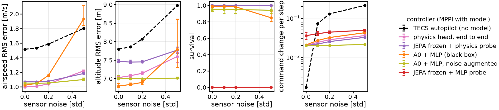

# Detailed results

Detail behind the [top-level README](../README.md). Implementation: [IMPLEMENTATION.md](IMPLEMENTATION.md). Earlier
experiments in another setting (2 s of history, aircraft parameters as input, turbulence):
[`results/README.md`](../results/README.md).

## The question

I repeat the SkyJEPA experiment (JEPA world model, frozen, read out by a physics-informed probe) on a simulated
Ultra Stick 120. SkyJEPA (Rao et al., arXiv 2606.23444) reports that a JEPA trunk with a physics probe beats a model
trained on the states, on a quadrotor. I asked whether that holds on a fixed wing, which is strongly nonlinear in
angle of attack and sideslip, and whether the physics should sit in a frozen probe or be trained with the network.
The same physics head trained end to end with the network predicts 5 s of flight with 5.8 m position error, against
8.1 m for SkyJEPA's recipe and 14.3 m for a direct state-loss baseline.

## Open-loop prediction

All models share one network (TCN encoders, GRU predictor, about 11k parameters) and the settings of the paper;
only the training recipe and the head change. Error at 5 s, open loop from 0.55 s of history and the commands,
on 200 test flights (half of them on extreme aircraft, outside the training range). Mean over 3 seeds.

| Model | Position, training-range (m) | Position, extreme (m) | Attitude, training-range (deg) | 1 s state error, noise 0.5 std |
| --- | --- | --- | --- | --- |
| Predictive: one-step state loss | 37.5 | 36.8 | 38.5 | 0.74 |
| A0: state loss on 1 s rollouts, MLP head (baseline) | 14.3 | 18.2 | 22.9 | 0.76 |
| JEPA, frozen, MLP probe | 15.4 | 18.5 | 23.2 | 0.57 |
| JEPA, frozen, physics probe (SkyJEPA's recipe) | 8.1 | 23.6 | 9.7 | 0.45 |
| Physics head trained end to end | 5.8 | 12.7 | 6.5 | 0.59 |
| Port-Hamiltonian head, end to end | 6.2 | 13.1 | 7.6 | 0.59 |
| A0 trained on noisy inputs | 13.8 | 18.5 | 22.8 | 0.15 |

Source: `results/<run>_s{0,1,2}/eval_skyjepa_test_long.json` (written by `scripts/eval_skyjepa.py`); the
full table with all ten recipes is printed by `python scripts/plot_skyjepa.py --runs results --out <dir>`.
Figure: [`figures/paper_fig2.png`](figures/paper_fig2.png), made by `scripts/plot_paper.py` (open loop, unseen 120 s
flights, mean over 3 seeds, bands: min-max).

- SkyJEPA's ranking holds: with the physics probe a JEPA trunk beats an A0 trunk (8.1 m against 10.8 m), and with
  an MLP probe the two tie. Most of the gain comes from the physics, not from JEPA.
- Freezing is what costs: the physics head trained with the network is better on both aircraft sets, and the
  frozen JEPA trunk does not transfer to extreme aircraft (23.6 m).
- The frozen JEPA latent degrades more slowly with observation noise than A0, but simple noise augmentation of
  A0's training inputs does much better (0.15 against 0.45).

## Closed loop

An MPPI controller (256 samples, 1.5 s horizon) plans with each model and flies 40 aircraft for 60 s of altitude and
speed changes, with sensor noise added to the measured states. Mean of both aircraft groups.

| Controller | Airspeed RMS, no noise (m/s) | Airspeed RMS, noise 0.5 (m/s) | Aircraft kept, noise 0 / 0.5 |
| --- | --- | --- | --- |
| TECS autopilot (no model) | 1.52 | 1.80 | 100 % / 100 % |
| MPPI + A0 | 1.02 | 1.93 | 99 % / 85 % |
| MPPI + A0 trained on noisy inputs | 1.05 | 1.10 | 95 % / 94 % |
| MPPI + JEPA, frozen, MLP probe | crashes | crashes | 0 % / 0 % |
| MPPI + JEPA, frozen, physics probe | 1.07 | 1.18 | 100 % / 100 % |
| MPPI + physics head, end to end | 1.00 | 1.22 | 100 % / 100 % |



*Source: `results/closed_loop/sweep_nz*_s*.json` (`scripts/closed_loop.py`), figure by `scripts/plot_closed_loop.py`.*

Only the controllers with a physics head keep every aircraft at every noise level. The JEPA model read out by an
MLP has an open-loop error close to A0's, yet MPPI crashes every aircraft with it within 7 to 11 s: open-loop error
alone does not tell which model can be flown.

## What I built

- `wingjepa/sim/`: a Python port of the University of Minnesota Ultra Stick 120 6-DoF model (NASA wind-tunnel
  tables), with Dryden turbulence, gusts and a TECS autopilot that flies the data-collection flights.
- `configs/data_calm.yaml`: 2,000 training flights of 30 s and 200 test flights of 120 s at 20 Hz, each with a
  random aircraft (mass, inertia, aerodynamics, motor and CG varied by 3 to 30 %; extreme test aircraft beyond).
- `wingjepa/models/`: causal TCN encoders for states and commands, GRU predictor, MLP head, and a physics head
  (`physics.py`) that outputs aerodynamic coefficients and integrates Newton-Euler with RK4 from the measured state;
  a port-Hamiltonian variant.
- `scripts/train_a.py`: the recipes (direct, JEPA with SIGReg, frozen trunk + probe, fine-tuning), physics in the
  loss, input-noise augmentation, and restartable training on Savio.
- `scripts/eval_skyjepa.py`, `scripts/closed_loop.py`: the SkyJEPA metrics and the MPPI closed-loop test.

## How I checked it

- The simulator port is compared with the UMN Simulink reference trajectories ([`figures/validation/`](figures/validation/)).
- Unit tests for the simulator, the encoders and the physics head (`python -m pytest -q`).
- Three seeds for every recipe; the seed ranges are in the JSON files.
- The closed-loop gains were tuned on A0 only, then kept fixed for all models; TECS is the reference.

## Limitations in detail

- Simulation only, and the flights come from my autopilot, which shapes the states the models see.
- The physics head is given the true mass and inertia; the MLP models get no aircraft parameters, so A0 is not a
  clean control for it. The comparison with SkyJEPA's frozen physics probe, which gets the same parameters, is.
- The states are fully observed, which removes most of what self-supervision could add.
- Noise in the tests is white; the closed-loop TECS has no sensor filter.
- Earlier experiments in another setting (2 s of history, aircraft parameters as input, turbulence) are in
  [`results/README.md`](../results/README.md); there the physics gain disappears in turbulence.

## Status

- [x] SkyJEPA's Table III on the fixed wing, 10 recipes, 3 seeds
- [x] Closed-loop MPPI test with sensor noise
- [ ] Physics head trained on noisy inputs (training on Savio)
- [ ] Turbulence in the SkyJEPA setting, physics inside the latent predictor

## Reproduce

Tested with Python 3.11 on Windows 10 (unit tests) and on Linux (training). Dependencies are not pinned.

```bash
pip install -e ".[dev]"
python -m pytest -q
bash scripts/fetch_umn.sh                 # NASA tables of the UMN model, not redistributed here
python scripts/plot_paper.py --runs results --out docs/figures/paper_fig2.pdf
python scripts/plot_closed_loop.py --dir results/closed_loop --out docs/figures/closed_loop_noise.pdf
```

Data and training ran on Berkeley's Savio cluster (Slurm, one A40 GPU per run, 20 min for A0, about 6 h for the
physics head), from the repository root ([`cluster/README.md`](../cluster/README.md)):

```bash
sbatch --array=0-19 cluster/gen_data.sbatch configs/data_calm.yaml train 20
sbatch --array=0-3  cluster/gen_data.sbatch configs/data_calm.yaml test_long 4
S="--H 11 --channels 8,8,16 --dilations 1,2,4 --z-dim 24 --aircraft-input 0 --action-encoder 1 --T 20 --device cuda"
sbatch cluster/train_a.sbatch a0 0 calm_sky $S
sbatch cluster/train_a.sbatch c_direct 0 calm_sky_nul $S --prior data/data_v1/priors/nul.json
python scripts/eval_skyjepa.py --data-dir data/data_calm --models runs/a0_calm_sky_s0 runs/c_direct_calm_sky_nul_s0
python scripts/closed_loop.py --controllers tecs runs/c_direct_calm_sky_nul_s0 --lam 0.1 --w-du 0.5 --noise 0.5
```
